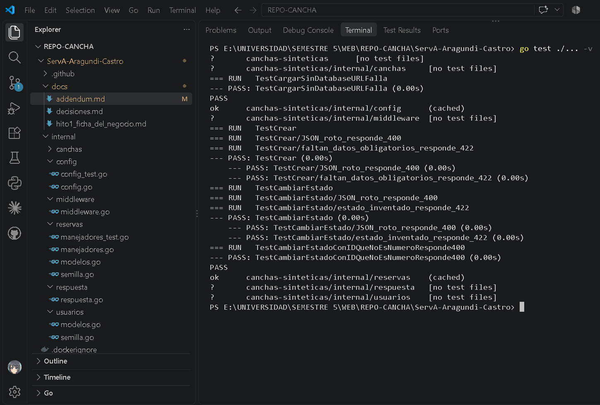
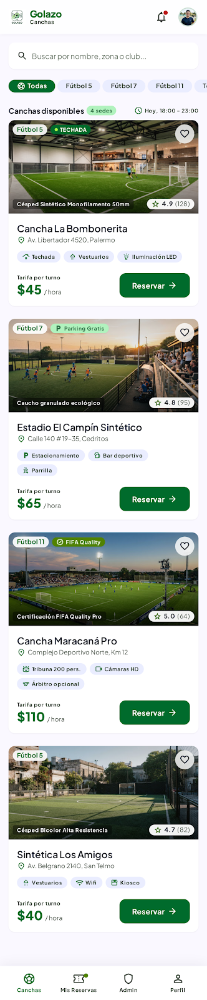
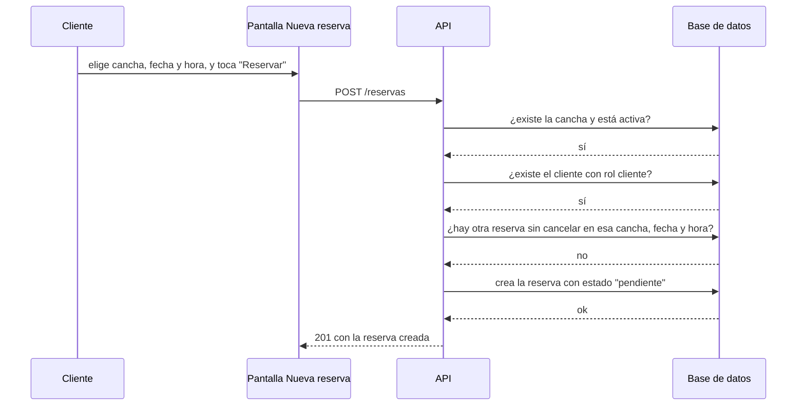
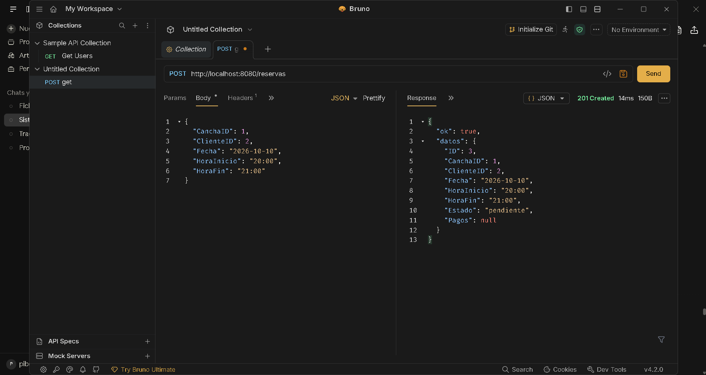
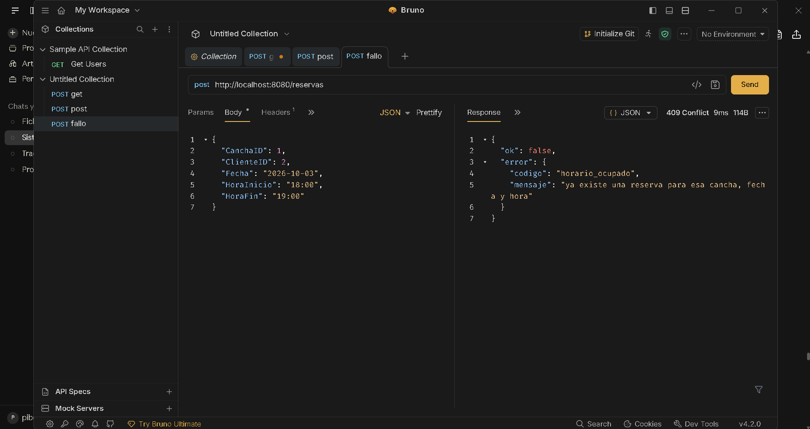

# Hito 1 · Addendum técnico

**Pareja:** Nilo Aragundi · Jorge Castro
**Paralelo:** A


## A. Estructura del proyecto

```
.
├── main.go # conexión, AutoMigrate, semillas y arranque del servidor
├── go.mod / go.sum
├── Dockerfile # build multi-etapa: compila y arma la imagen final
├── docker-compose.yml # levanta el servidor + PostgreSQL juntos
├── .dockerignore
├── .env.example # plantilla de variables de entorno (sí se sube)
├── .env # variables reales de esta máquina (NO se sube, está en .gitignore)
├── .gitignore
├── .github/workflows/pruebas.yml # corre go test ./... en cada push
├── docs/decisiones.md # D1-D4: decisiones de diseño discutidas y su alternativa descartada
└── internal/
├── respuesta/ # envoltura única de las respuestas: {"ok": ...}
│ └── respuesta.go
├── middleware/ # Registro (log de cada petición) y Recuperacion (atrapa pánicos)
│ └── middleware.go
├── config/ # lee .env y las variables de entorno del sistema
│ ├── config.go
│ └── config_test.go
├── usuarios/ # entidad Usuario (cliente/administrador); sin rutas propias todavía
│ ├── modelos.go
│ └── semilla.go
├── canchas/ # Cancha y Horario (uno-a-muchos) + CRUD del catálogo
│ ├── modelos.go
│ ├── manejadores.go
│ └── semilla.go
└── reservas/ # Reserva (con la máquina de estados) y Pago + pruebas
├── modelos.go
├── manejadores.go
├── semilla.go
└── manejadores_test.go
```


## B. Configuración y secretos

| Variable | Para qué sirve | Ejemplo (sin datos reales) |
|----------|----------------|----------------------------|
| `DATABASE_URL` | Cadena de conexión a PostgreSQL. Es un secreto: lleva la contraseña, no tiene valor por defecto y el servidor no arranca sin ella. | `host=localhost user=postgres password=**** dbname=canchas port=5432` |
| `PUERTO` | Puerto donde escucha el servidor HTTP. No es secreto, cambia por máquina. Si se omite, usa `8080`. | `8080` |
| `TIEMPO_ESPERA_SEGUNDOS` | Segundos que espera el servidor antes de cortar una petición lenta (`ReadTimeout`/`WriteTimeout`). Si se omite, usa `5`. | `5` |

**Archivo de ejemplo:** `.env.example` (en la raíz del repositorio). El `.env` real está en `.gitignore` y nunca se sube; dentro de Docker, `DATABASE_URL` se redefine directamente en `docker-compose.yml` con `host=db` en vez de `host=localhost` (ver `docs/decisiones.md`, decisión D4).

## C. Pruebas

| Prueba | Qué caso cubre |
|--------|----------------|
| `TestCargarSinDatabaseURLFalla` (`internal/config`) | Si falta `DATABASE_URL`, `Cargar()` devuelve un error que menciona esa variable, en vez de arrancar con un valor vacío. |
| `TestCrear/JSON_roto_responde_400` (`internal/reservas`) | `POST /reservas` con un cuerpo JSON mal formado responde `400 cuerpo_malformado`. |
| `TestCrear/faltan_datos_obligatorios_responde_422` (`internal/reservas`) | `POST /reservas` sin `fecha`, `hora_inicio` u `hora_fin` responde `422 datos_invalidos`, antes de tocar la base de datos. |
| `TestCambiarEstado/JSON_roto_responde_400` (`internal/reservas`) | `PATCH /reservas/{id}/estado` con un cuerpo mal formado responde `400 cuerpo_malformado`. |
| `TestCambiarEstado/estado_inventado_responde_422` (`internal/reservas`) | Pedir un estado que no existe (por ejemplo `"volando"`) responde `422 estado_invalido`, antes de consultar la reserva. |
| `TestCambiarEstadoConIDQueNoEsNumeroResponde400` (`internal/reservas`) | Un id no numérico en la URL responde `400 id_invalido` sin llegar a la base de datos. |

**Captura de `go test ./...`:** 

## D. Boceto de la pantalla principal



## E. Diagrama de secuencia del caso de uso principal



## F. Capturas de respuestas

**Caso correcto:** 

**Caso con error de validación:** 