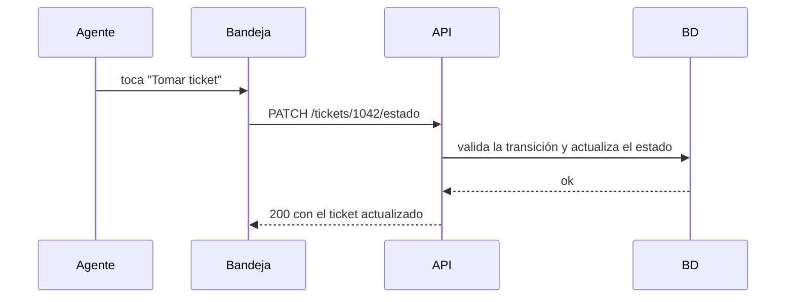

# Hito 1 · Addendum técnico

**Pareja:** Nilo Aragundi · Jorge Castro
**Paralelo:** A

<!-- Aquí va lo que no cabe en las diapositivas. Se entrega junto con la ficha, en docs/hito1_addendum.md.
     Borren todos los comentarios como este antes de entregar. -->

## A. Estructura del proyecto

<!-- El árbol de carpetas, con una línea por cada una diciendo qué guarda. -->

```
.
├───.github
│   └───workflows
├───cdm
│   └───servidor
├───docs
└───internal
    ├───config
    ├───database
    ├───handlers
    ├───middleware
    ├───models
    └───routes
```

## B. Configuración y secretos

<!-- Qué variables de entorno usa el proyecto y para qué. Confirmen que existe el archivo de ejemplo
     (.env.example o equivalente) y que el repositorio no tiene credenciales reales. -->

| Variable | Para qué sirve | Ejemplo (sin datos reales) |
|----------|----------------|----------------------------|
|          |                |                            |
|          |                |                            |

**Archivo de ejemplo:** (ruta en el repositorio)

## C. Pruebas

<!-- Cuántas pruebas tienen y qué caso cubre cada una. Después, la captura de la corrida. -->

| Prueba | Qué caso cubre |
|--------|----------------|
|        |                |
|        |                |

**Captura de `go test ./...`:** 

## D. Boceto de la pantalla principal

<!-- La pantalla que consume el endpoint de listado. A mano y fotografiada, o en cualquier herramienta.
     Tiene que verse qué campos muestra y dónde aparece el estado. -->


## E. Diagrama de secuencia del caso de uso principal

<!-- Actor → pantalla → endpoint → base de datos. GitHub dibuja Mermaid solo.
     Borren el ejemplo y pongan el suyo. -->



## F. Capturas de respuestas

<!-- Dos capturas: una petición que sale bien y una que falla la validación. Que se vea el código. -->

**Caso correcto:** 

**Caso con error de validación:** 