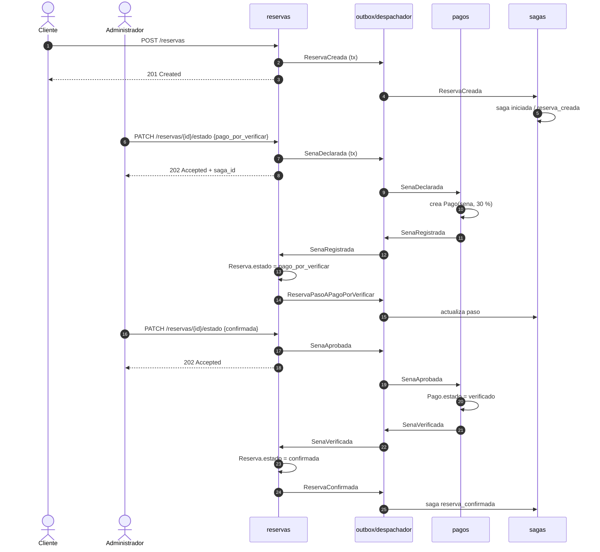
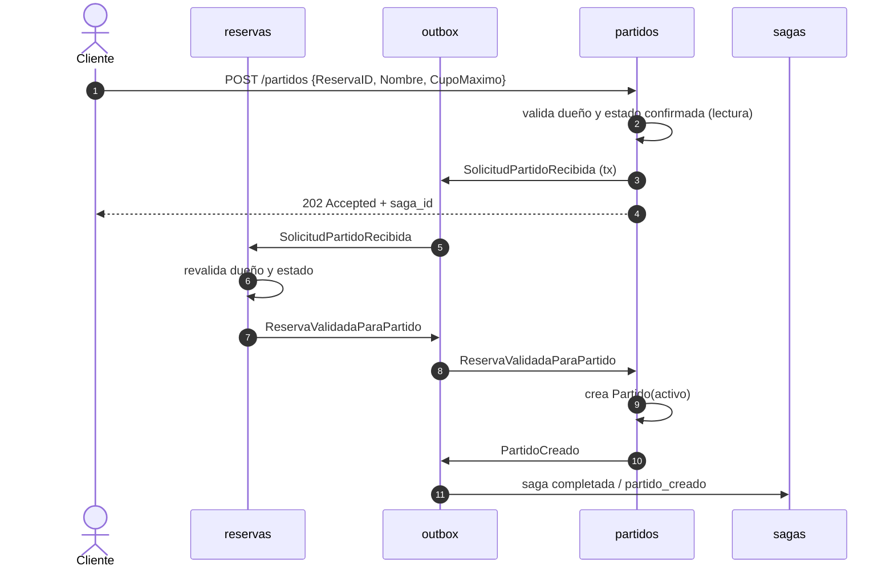
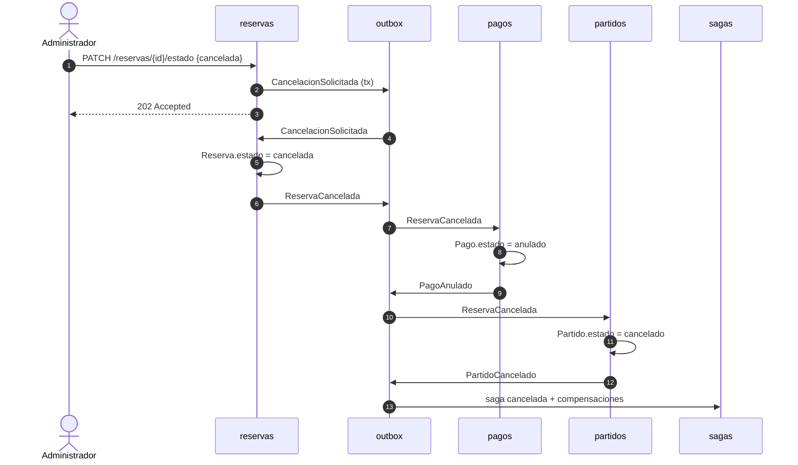

# Arquitectura

## 1. Objetivo y restricciones

El sistema pasa de un flujo síncrono en un solo paquete a una **Saga
Coreografía** dentro de un **monolito modular**. Las restricciones que guían el
diseño son:

- Un solo binario y una sola base PostgreSQL: no se despliega infraestructura
  de mensajería.
- Los contextos de negocio no comparten tablas de escritura.
- La API responde rápido y no bloquea al cliente mientras se ejecutan pasos
  secundarios.
- Los efectos deben ser auditables y reintentables: no se permite perder un
  evento si el proceso cae.
- No hay borrados físicos para compensar: se usan estados terminales.

## 2. Estilo: monolito modular + coreografía

```
┌─────────────────────────────────────────────────────────────────────┐
│                         Proceso Go único                            │
│                                                                     │
│  HTTP (Chi)                                                         │
│   │                                                                 │
│   ├── canchas ───────┐                                              │
│   ├── reservas ──────┤  escriben estado + evento en una transacción  │
│   ├── partidos ──────┤                                              │
│   ├── inscripcion ───┘                                              │
│   │                                                                 │
│   ▼                                                                 │
│  ┌────────────────────────────────────────────────────────────┐     │
│  │ eventos: outbox (tabla eventos) + despachador + bus         │     │
│  └────────────────────────────────────────────────────────────┘     │
│   │                                                                 │
│   ├──► reservas  (consume y publica hechos de la reserva)            │
│   ├──► pagos     (consume y publica hechos de la seña)               │
│   ├──► partidos  (consume y publica hechos del partido)              │
│   └──► sagas     (proyección de solo lectura)                        │
│                                                                     │
│  PostgreSQL: usuarios, canchas, reservas, pagos, partidos,           │
│              inscripciones, cuentas, eventos, eventos_procesados,    │
│              sagas                                                   │
└─────────────────────────────────────────────────────────────────────┘
```

**Coreografía** significa que ningún componente tiene el guion completo. Cada
contexto conoce sus propias reglas y reacciona a los hechos que le importan.
Por ejemplo, `pagos` no sabe cómo se confirma una reserva; solo sabe que al
recibir `SenaAprobada` debe verificar la seña y publicar `SenaVerificada`.
`reservas` decide si ese hecho permite confirmar.

La proyección `sagas` es un observador: no publica eventos ni ejecuta pasos.
Sirve para que el cliente consulte el avance y para auditar.

## 3. Contextos y responsabilidades

| Contexto | Dueño de | Publica | Consume |
| --- | --- | --- | --- |
| `usuarios` | `Usuario` | — | — |
| `canchas` | `Cancha`, `Horario` | — | — |
| `reservas` | `Reserva` | `ReservaCreada`, `ReservaPasoAPagoPorVerificar`, `ReservaConfirmada`, `ReservaCancelada`, `ReservaJugada`, `ReservaNoActualizada`, `ReservaNoConfirmada`, `ReservaValidadaParaPartido`, `PartidoFallido` | `SenaRegistrada`, `SenaVerificada`, `RegistroSenaFallido`, `VerificacionSenaFallida`, `CancelacionSolicitada`, `JugadaSolicitada`, `SolicitudPartidoRecibida` |
| `pagos` | `Pago` | `SenaRegistrada`, `SenaVerificada`, `RegistroSenaFallido`, `VerificacionSenaFallida`, `PagoAnulado`, `VerificacionRevertida` | `SenaDeclarada`, `SenaAprobada`, `ReservaCancelada`, `ReservaNoActualizada`, `ReservaNoConfirmada`, `ProcesamientoFallido` |
| `partidos` | `Partido` | `PartidoCreado`, `PartidoCancelado` | `ReservaValidadaParaPartido`, `ReservaCancelada` |
| `inscripcion` | `Inscripcion` | — | — |
| `sesion` | `Cuenta`, tokens | — | — |
| `eventos` | outbox, idempotencia, bus | — | — |
| `sagas` | proyección `Saga` | — | todos (`*`) |

`partidos` tiene una lectura de `reservas.Reserva` para validar la petición
HTTP antes de aceptar el `202` (existencia, dueño y estado `confirmada`). Es
una **lectura de solo lectura** para dar errores síncronos; la decisión de
negocio se vuelve a validar en `reservas` al consumir
`SolicitudPartidoRecibida`.

## 4. Flujo de un evento

1. **Validación síncrona** en el manejador HTTP: forma del cuerpo, token, rol,
   propiedad y transición. Los errores `400/401/403/404/422` se devuelven aquí.
2. **Transacción local**: el caso de uso guarda el cambio de estado y el
   evento en la tabla `eventos` en la misma transacción. Si algo falla, no
   queda ni el cambio ni el evento.
3. **Respuesta `202`**: se devuelve `saga_id`, `Location: /sagas/{id}` y el
   estado actual de la proyección.
4. **Despacho**: el `Despachador` consulta eventos `pendiente`, los entrega al
   `BusEnMemoria` y marca `publicado`. Si un consumidor falla, marca el intento
   y reintenta hasta `MaxIntentos = 5`.
5. **Consumo idempotente**: cada consumidor envuelve su cambio en
   `ProcesadorGORM.Procesar`, que inserta `(evento_id, consumidor)` en
   `eventos_procesados` dentro de la misma transacción. Si ya existe, no repite
   el efecto.
6. **Nuevos hechos**: el consumidor devuelve eventos derivados; el procesador
   los guarda en el outbox dentro de la misma transacción. El despachador los
   recogerá en el siguiente tick.
7. **Proyección**: `sagas` recibe todos los eventos y actualiza `sagas` con el
   último paso, estado, error y recurso.

### Por qué outbox y no publicar directo al bus

Si el manejador guardara la reserva y luego publicara en memoria, un crash
entre ambos pasos perdería el evento. El outbox invierte el orden: primero se
persiste el hecho, después se publica. El precio es un pequeño retraso (el
intervalo del despachador, 100 ms) y la necesidad de idempotencia.

### Garantías

- **At-least-once**: un evento puede entregarse más de una vez.
- **Idempotencia por consumidor**: el efecto se aplica una sola vez por
  `(evento, consumidor)`.
- **Orden**: el outbox se procesa por `ocurrido_en`; los eventos se generan
  con una marca estrictamente creciente y los eventos derivados se encolan
  después de su causa. La proyección descarta eventos anteriores a
  `ultimo_evento_en`, así una reentrega vieja no la hace retroceder. No hay
  orden global entre sagas distintas.
- **Consistencia eventual**: la reserva y la saga pueden estar unos milisegundos
  desincronizadas. El cliente hace polling.

## 5. Diagramas de secuencia

### 5.1 Pago de seña y confirmación



### 5.2 Creación de partido



### 5.3 Cancelación y compensación



## 6. Manejo de fallos

| Fallo | Detección | Reacción |
| --- | --- | --- |
| El cuerpo o la transición no son válidos | Manejador HTTP | `400/422`, no se publica nada. |
| La reserva no pertenece al cliente | Manejador / consumidor | `403` o `PartidoFallido`. |
| `pagos` no puede crear la seña | `Procesador` devuelve error | Se publica `RegistroSenaFallido`; la saga queda `fallida`. |
| `reservas` no puede guardar el paso a `pago_por_verificar` | Error en la transacción | Se publica `ReservaNoActualizada`; `pagos` anula la seña. |
| `reservas` no puede confirmar | Error en la transacción | Se publica `ReservaNoConfirmada`; `pagos` revierte la verificación. |
| Un consumidor falla repetidamente | Despachador agota 5 intentos | Se publica `ProcesamientoFallido`; la saga queda `fallida`. |
| El proceso se cae | Al reiniciar | El outbox conserva `pendiente`; el despachador reintenta. |

No hay compensación infinita: si una compensación también falla, queda
registrada como evento fallido y la saga en `fallida` para revisión manual.

## 7. Evolución a un broker

El bus está detrás de la interfaz `eventos.Bus`:

```go
type Bus interface {
    Publicar(ctx context.Context, evento Evento) error
    Suscribir(tipo string, manejador Manejador)
}
```

Para cambiar a Kafka/RabbitMQ se reemplaza `BusEnMemoria` por una
implementación que publique al broker y un consumidor que invoque a los
suscriptores. El outbox, la idempotencia y los contratos de eventos no cambian.
El precio de la migración es operativo (broker, particiones, monitoreo), no de
dominio; por eso se difiere hasta que el volumen lo justifique.

## 8. Decisiones de diseño visibles en el código

- `sagas.IDDeReserva(id)` es determinista (`reserva-{id}`): evita que el
  manejador y la proyección compitan por crear la misma saga.
- Los eventos de compensación usan un ID determinista
  (`evento.ID + "-" + tipo`): si el consumidor reintenta, el consumidor de la
  compensación no duplica el efecto.
- `Pago` salió de `reservas` a `pagos`; `Reserva.Pagos` queda como relación de
  lectura para `GET /reservas/{id}`.
- `Partido.Estado` se agregó para compensar sin borrar.
- La API sigue devolviendo la envoltura `ok/datos/error` existente.

Véase [`decisiones.md`](decisiones.md) para el registro de ADRs.
