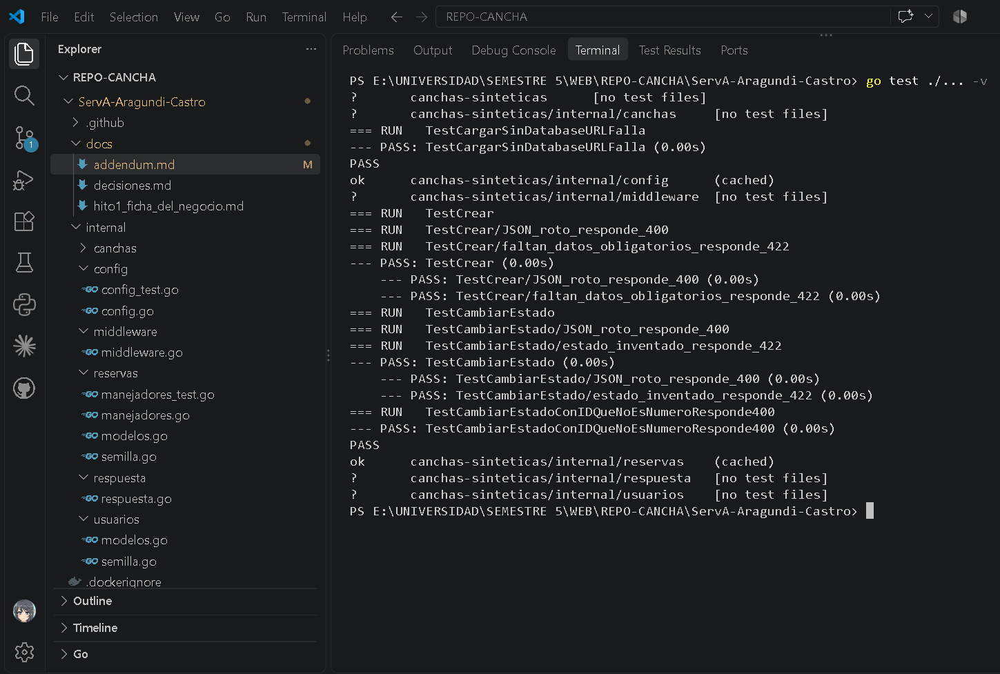
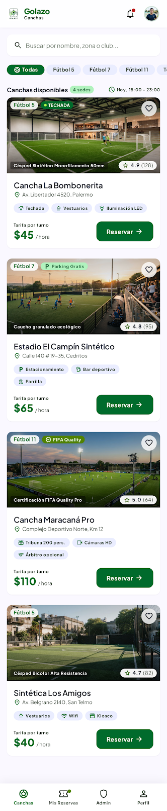
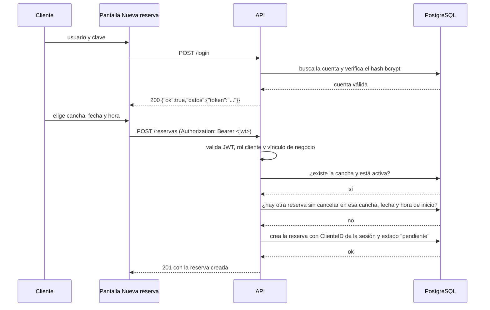
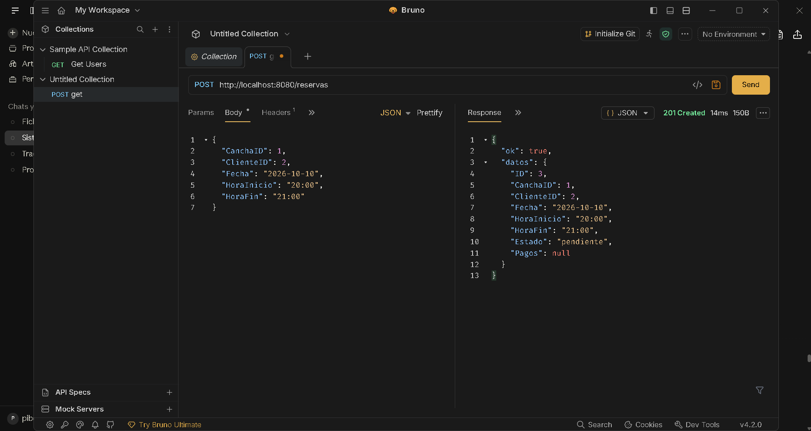
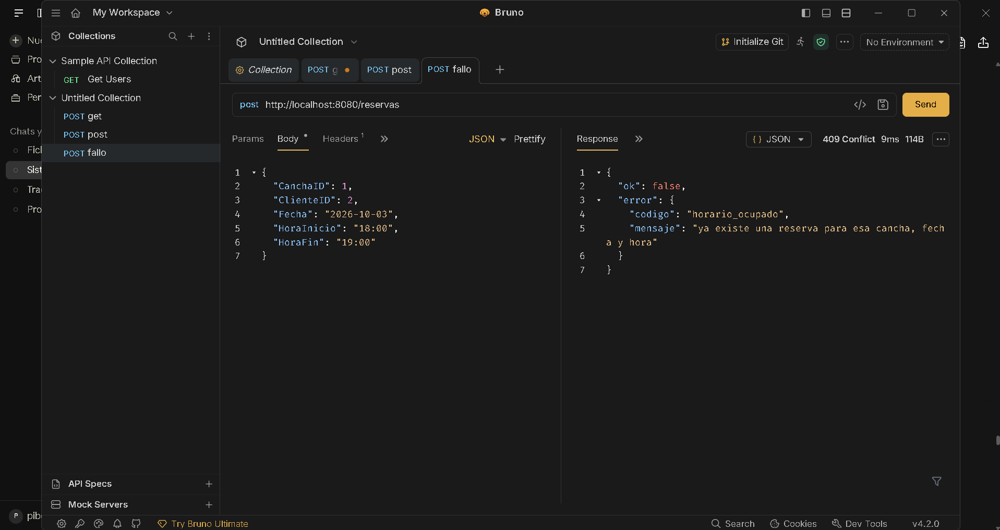

# Hito 1 · Addendum técnico

**Pareja:** Nilo Aragundi · Jorge Castro
**Paralelo:** A

## A. Estructura del proyecto

```text
.
├── main.go # conexión, AutoMigrate, semillas, middleware y registro de rutas
├── go.mod / go.sum
├── iniciar.bat / detener.bat
├── Dockerfile # build multi-etapa: compila y arma la imagen final
├── docker-compose.yml # levanta el servidor + PostgreSQL juntos
├── .dockerignore
├── .env.example # plantilla de variables de entorno (sí se sube)
├── .env # variables reales de esta máquina (NO se sube, está en .gitignore)
├── .gitignore
├── .github/workflows/pruebas.yml # corre go test ./... en cada push
├── redocly.yaml # configuración de validación del contrato OpenAPI
├── docs/
│   ├── openapi.yaml # contrato OpenAPI 3.1 de los endpoints reales
│   ├── api.html # página Redoc 3 generada y autocontenida
│   ├── decisiones.md # D1-D5: decisiones de diseño y su alternativa descartada
│   ├── hito1_ficha_del_negocio.md
│   ├── hito1_addendum.md
│   └── hito1_*.png # capturas del Hito 1
└── internal/
    ├── respuesta/ # envoltura única de las respuestas: {"ok": ...}
    ├── middleware/ # Registro (log de cada petición) y Recuperacion (atrapa pánicos)
    ├── config/ # lee .env y las variables de entorno del sistema
    ├── usuarios/ # entidad Usuario (cliente/administrador); sin rutas propias
    ├── sesion/ # login, JWT HS256, guardia, roles y vínculos de negocio
    ├── canchas/ # Cancha y Horario (uno-a-muchos) + catálogo y pruebas
    ├── reservas/ # Reserva, Pago, máquina de estados, repositorio y pruebas
    ├── partidos/ # Partido a partir de una reserva confirmada + pruebas
    └── inscripcion/ # Inscripción a partidos + pruebas
```

## B. Configuración y secretos

| Variable | Para qué sirve | Ejemplo (sin datos reales) |
|----------|----------------|----------------------------|
| `DATABASE_URL` | Cadena de conexión a PostgreSQL. Es un secreto: lleva la contraseña, no tiene valor por defecto y el servidor no arranca sin ella. | `host=localhost user=postgres password=**** dbname=canchas port=5432` |
| `CLAVE_FIRMA` | Secreto con el que se firman los JWT HS256. No tiene valor por defecto y el servidor no arranca sin ella. | `texto-largo-e-inventado` |
| `PUERTO` | Puerto donde escucha el servidor HTTP. No es secreto, cambia por máquina. Si se omite, usa `8080`. | `8080` |
| `TIEMPO_ESPERA_SEGUNDOS` | Segundos que espera el servidor antes de cortar una petición lenta (`ReadTimeout`/`WriteTimeout`). Si se omite, usa `5`. | `5` |

**Archivo de ejemplo:** `.env.example` (en la raíz del repositorio). El `.env` real está en `.gitignore` y nunca se sube. `iniciar.bat` copia `.env.example` si no existe `.env`; el valor `CAMBIE_ESTO` de `CLAVE_FIRMA` es solo un marcador y debe reemplazarse antes de usar la API. Dentro de Docker, `DATABASE_URL` se redefine directamente en `docker-compose.yml` con `host=db` en vez de `host=localhost` (ver `docs/decisiones.md`, decisión D4), y `CLAVE_FIRMA` se toma del entorno o del `.env` que lee Docker Compose.

## C. Pruebas

| Prueba | Qué caso cubre |
|--------|----------------|
| `TestCargarSinDatabaseURLFalla` (`internal/config`) | Si falta `DATABASE_URL`, `Cargar()` devuelve un error que menciona esa variable, en vez de arrancar con un valor vacío. |
| `TestCargarSinClaveFirmaFalla` (`internal/config`) | Si falta `CLAVE_FIRMA`, el servidor no arranca y el error menciona la variable. |
| `TestCrear/JSON_roto_responde_400` (`internal/reservas`) | `POST /reservas` con un cuerpo JSON mal formado responde `400 cuerpo_malformado`. |
| `TestCrear/faltan_datos_obligatorios_responde_422` (`internal/reservas`) | `POST /reservas` sin `Fecha`, `HoraInicio` u `HoraFin` responde `422 datos_invalidos`, antes de tocar la base de datos. |
| `TestCambiarEstado/JSON_roto_responde_400` (`internal/reservas`) | `PATCH /reservas/{id}/estado` con un cuerpo mal formado responde `400 cuerpo_malformado`. |
| `TestCambiarEstado/estado_inventado_responde_422` (`internal/reservas`) | Pedir un estado que no existe (por ejemplo `"volando"`) responde `422 estado_invalido`, antes de consultar la reserva. |
| `TestCambiarEstadoConIDQueNoEsNumeroResponde400` (`internal/reservas`) | Un id no numérico en la URL responde `400 id_invalido` sin llegar a la base de datos. |

Las pruebas incorporadas en J3–J7 cubren, además:

- **Sesión y JWT** (`internal/sesion`): login público, token válido, contraseña incorrecta, cuenta inexistente, JSON roto, error interno sin detalles, token ausente/mal formado, token vencido, firma inválida, algoritmo distinto de HS256 y token sin expiración.
- **Roles y vínculos**: rol incorrecto responde `403`, cuenta sin vínculo de negocio responde `403 cuenta_sin_vinculo`, y el vínculo usa el ID de la cuenta, no el del usuario.
- **Canchas**: cliente no administra, administrador solo ve y edita sus canchas, y el administrador de creación se toma de la sesión.
- **Reservas**: cliente crea para sí mismo e ignora `ClienteID` del cuerpo, conflicto determinista `409 horario_ocupado`, administrador solo lista/consulta/cambia reservas de sus canchas, transición inválida `422 transicion_invalida`.
- **Partidos e inscripciones**: cliente solo crea el partido de su reserva confirmada, no puede inscribir a otro jugador ni inscribirse dos veces, y el administrador recibe `403`.

**Captura de `go test ./...`:** 

Las capturas de esta sección corresponden al Hito 1. El detalle actualizado de la autenticación y del contrato está en las secciones E y G.

## D. Boceto de la pantalla principal



## E. Diagrama de secuencia del caso de uso principal



El `ClienteID` ya no se toma de la solicitud: sale de la cuenta autenticada. El cliente no puede crear una reserva a nombre de otro usuario.

## F. Capturas de respuestas

**Caso correcto:** 

**Caso con error de validación:** 

## G. Contrato OpenAPI y documentación (Hito 2)

- **`docs/openapi.yaml`** documenta los 11 endpoints implementados: login; listar, crear y actualizar canchas; crear y listar reservas; obtener una reserva; cambiar el estado de una reserva; crear partidos; consultar el detalle de un partido; e inscribirse en un partido.
- También documenta la seguridad HTTP Bearer JWT, los roles, la propiedad de los recursos, la envoltura real de éxito/error, los códigos HTTP reales y las respuestas globales `404 ruta_inexistente` y `405 metodo_no_permitido`.
- **`docs/api.html`** es una página estática generada con Redocly CLI `2.71.0` y Redoc 3. El contrato y el bundle de Redoc están embebidos: no usa CDN ni depende de un archivo local ausente. Se puede abrir directamente con doble clic.
- La validación se ejecutó con:

  ```bash
  npx @redocly/cli@2.71.0 lint docs/openapi.yaml
  npx @redocly/cli@2.71.0 build-docs docs/openapi.yaml -o docs/api.html --inlineBundle
  ```

  `redocly.yaml` configura las reglas recomendadas y `security-defined: error`; el contrato pasa sin errores ni warnings. La página se regenera desde el YAML; no se edita a mano.

El contrato refleja el código real por encima de la ficha antigua: los modelos salen en PascalCase, `PATCH /reservas/{id}/estado` es solo de administrador, la transición inválida responde `422`, no existe `requiere_comprobante`, las fechas y horas no se validan y `GET /partidos/{id}` no aplica propiedad. No se añadieron rutas `(plan)` porque la sección 7 de la ficha del Hito 1 no identifica endpoints adicionales y no hay un enunciado del Hito 2 en el repositorio.

Las pruebas se ejecutaron con dobles deterministas y no se hizo una integración contra un PostgreSQL real; tampoco se incluyen tokens, claves ni contraseñas reales en la documentación.
