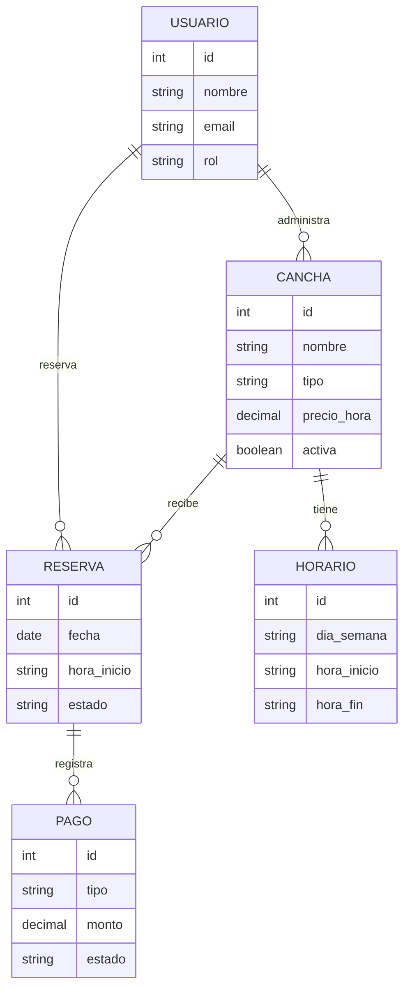
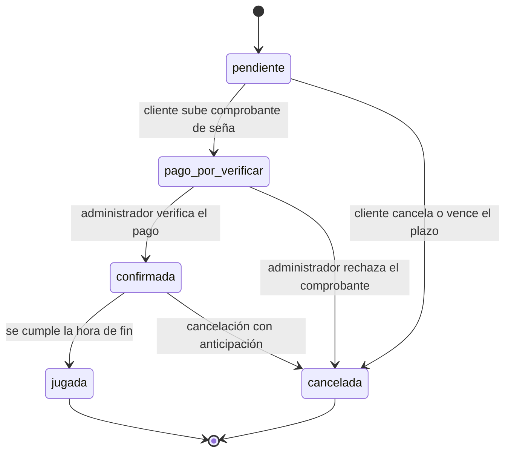

# Hito 1 · Ficha del negocio

**Pareja:** Nilo Aragundi · Jorge Castro
**Paralelo:** Aplicación para el Servidor Web A
**Negocio en una línea:** (Sistema de reservas de canchas de futbol sinteticas para dueños y administradores de complejos deportivos, centros de recreación, clubes de fútbol y ligas barriales que buscan digitalizar el alquiler de sus espacios. )

## 1. Negocio de referencia

Nuestro caso de referencia es **Swift App**, una plataforma fundada en Toronto en noviembre de 2021 por Jeet Mehta y dos amigos. Swift vende un software de suscripción mensual (SaaS) a dueños de instalaciones deportivas —inicialmente canchas de béisbol bajo techo— para que gestionen reservas, pagos en línea, horarios de instructores y reportes del negocio, reemplazando el registro manual y las llamadas telefónicas constantes. Cobra a los dueños de las canchas, no a los jugadores: una suscripción mensual por el software, más el procesamiento de pagos. Los tres fundadores declaran que la empresa factura 10.000 USD al mes (unos 120.000 USD al año), que ha sido rentable desde el primer día y que el valor estimado de cada cliente a lo largo del tiempo (LTV) ronda los 4.000 USD. El caso es prácticamente análogo al nuestro: mismo problema (gestión y reserva de espacios deportivos), mismo tipo de cliente (dueño de la instalación) y mismo mecanismo de cobro (suscripción, no comisión por reserva).

Caso: https://www.starterstory.com/stories/swift-app

## 2. Caso de contraste

El contraejemplo es "Partidazo", una app argentina de reservas de canchas de fútbol 5 que su propio fundador documentó como fracaso, junto con al menos otras cinco apps del mismo mercado (Fubles, ClickyReserva, Matchear, Canchas.com.ar) que fracasaron o se estancaron entre 2014 y 2016. Nuestra hipótesis de fondo: todas construyeron su propuesta de valor asumiendo que resolver el problema del jugador (conseguir cancha y rivales) se traducía automáticamente en el problema del dueño de la cancha (más reservas). Pero el propio fundador descubrió que el grueso de los ingresos de un complejo deportivo viene de los turnos fijos y recurrentes, no de las horas libres ocasionales que una app podría llenar — así que "más reservas" nunca fue una necesidad real ni urgente para ese lado del mercado. A eso se suma que muchos dueños de canchas operan con ingresos no declarados, y un sistema que deja rastro digital de cada turno se percibe como una amenaza, no como una ayuda.

Caso: https://medium.com/@j.ignacioarroyo/aprendizajes-de-fundir-mi-primer-emprendimiento-7a77be35b70a

## 3. Adaptación al Ecuador

1. **Medios de pago.** La mayoría de los clientes en Ecuador paga por transferencia bancaria y envía la foto del comprobante, no con tarjeta. *Efecto:* el sistema no puede dar por confirmada una reserva apenas se crea. *Qué cambió:* la Reserva necesita un estado intermedio, `pago_por_verificar`, entre que el cliente reserva y que el administrador confirma haber recibido la transferencia. **Esta es la restricción que cambia la máquina de estados.**

2. **Facturación electrónica del SRI y régimen RIMPE.** Muchos dueños de canchas sintéticas en Ecuador operan como emprendimientos pequeños, inscritos en RIMPE (emprendedor o negocio popular), no como sociedades con facturación electrónica plena. *Efecto:* el sistema no puede asumir que toda reserva pagada genera automáticamente una factura electrónica con retención. *Qué cambió:* se agrega al modelo un dato simple —si el cliente requiere o no comprobante— en vez de forzar un flujo de facturación electrónica completo desde el Hito 1.

3. **Poder adquisitivo e informalidad en las cancelaciones.** Es común que un grupo reserve una cancha y no se presente, sin avisar, dejando ese horario perdido para el dueño. *Efecto:* el negocio necesita algún mecanismo de compromiso antes de bloquear el horario para otros. *Qué cambió:* se evaluó agregar un campo de monto de seña o abono a la Reserva, para que la confirmación dependa de un pago parcial y no solo de la promesa de asistencia.

## 4. Modelo de datos

### Usuario

| Atributo | Tipo | Obligatorio | Ejemplo |
| --- | --- | --- | --- |
| id | número entero | sí | 1 |
| nombre | texto | sí | María Pérez |
| email | texto | sí | maria@gmail.com |
| telefono | texto | no | 0991234567 |
| rol | uno de: cliente, administrador | sí | cliente |
| creado | fecha y hora | sí | 14-09-2026 10:32 |

### Cancha

| Atributo | Tipo | Obligatorio | Ejemplo |
| --- | --- | --- | --- |
| id | número entero | sí | 1 |
| nombre | texto | sí | Cancha El Golazo 1 |
| tipo | uno de: fútbol 5, fútbol 7, fútbol 11 | sí | fútbol 5 |
| direccion | texto | sí | Av. Los Shyris y Naciones Unidas |
| precio_hora | número decimal | sí | 25.00 |
| activa | sí/no | sí | sí |
| administrador | referencia a Usuario | sí | (id del administrador) |

### Horario

| Atributo | Tipo | Obligatorio | Ejemplo |
| --- | --- | --- | --- |
| id | número entero | sí | 1 |
| cancha | referencia a Cancha | sí | (id de la cancha) |
| dia_semana | uno de: lunes, martes, miércoles, jueves, viernes, sábado, domingo | sí | sábado |
| hora_inicio | texto | sí | 18:00 |
| hora_fin | texto | sí | 19:00 |
| activo | sí/no | sí | sí |

### Reserva

| Atributo | Tipo | Obligatorio | Ejemplo |
| --- | --- | --- | --- |
| id | número entero | sí | 1 |
| cancha | referencia a Cancha | sí | (id de la cancha) |
| cliente | referencia a Usuario | sí | (id del cliente) |
| fecha | fecha | sí | 21-10-2026 |
| hora_inicio | texto | sí | 19:00 |
| hora_fin | texto | sí | 20:00 |
| estado | uno de: pendiente, pago por verificar, confirmada, jugada, cancelada | sí | pendiente |
| creado | fecha y hora | sí | 14-09-2026 10:32 |

### Pago

| Atributo | Tipo | Obligatorio | Ejemplo |
| --- | --- | --- | --- |
| id | número entero | sí | 1 |
| reserva | referencia a Reserva | sí | (id de la reserva) |
| tipo | uno de: seña, saldo | sí | seña |
| monto | número decimal | sí | 12.50 |
| metodo | uno de: transferencia, efectivo, tarjeta | sí | transferencia |
| comprobante_url | texto | no | https://.../comprobante123.jpg |
| estado | uno de: pendiente, verificado, rechazado | sí | pendiente |
| pagado | fecha y hora | no | 14-09-2026 10:40 |

### Relaciones

| Entidades | Cardinalidad | Frase |
| --- | --- | --- |
| Usuario – Cancha | 1 a N | Un administrador administra muchas canchas; cada cancha pertenece a un solo administrador. |
| Usuario – Reserva | 1 a N | Un cliente hace muchas reservas; cada reserva pertenece a un solo cliente. |
| Cancha – Horario | 1 a N | Una cancha tiene muchos horarios recurrentes; cada horario pertenece a una sola cancha. |
| Cancha – Reserva | 1 a N | Una cancha recibe muchas reservas; cada reserva es de una sola cancha. |
| Reserva – Pago | 1 a N | Una reserva tiene uno o más pagos (seña y/o saldo); cada pago pertenece a una sola reserva. |

**Decisión discutible:** Pago es una entidad y no un campo de la Reserva, porque una misma reserva puede tener más de un pago asociado (la seña y luego el saldo), y cada uno necesita su propio método, comprobante, fecha y estado de verificación independientes — no alcanza con un solo campo "pagado: sí/no" en la Reserva.

### Los structs en Go

```go
package models

import "time"

// --- Usuario ---

type Rol string

const (
	RolCliente       Rol = "cliente"
	RolAdministrador Rol = "administrador"
)

type Usuario struct {
	ID             uint      `gorm:"primaryKey" json:"id"`
	Nombre         string    `gorm:"size:120;not null" json:"nombre"`
	Email          string    `gorm:"size:160;uniqueIndex;not null" json:"email"`
	Telefono       string    `gorm:"size:20" json:"telefono,omitempty"`
	ContrasenaHash string    `gorm:"size:255;not null" json:"-"`
	Rol            Rol       `gorm:"type:varchar(20);not null" json:"rol"` // validado en el service: solo "cliente" o "administrador"
	CreadoEn       time.Time `gorm:"autoCreateTime" json:"creado_en"`
}

// --- Cancha ---

type TipoCancha string

const (
	TipoFutbol5  TipoCancha = "futbol_5"
	TipoFutbol7  TipoCancha = "futbol_7"
	TipoFutbol11 TipoCancha = "futbol_11"
)

type Cancha struct {
	ID              uint       `gorm:"primaryKey" json:"id"`
	Nombre          string     `gorm:"size:120;not null" json:"nombre"`
	Tipo            TipoCancha `gorm:"type:varchar(20);not null" json:"tipo"`
	Direccion       string     `gorm:"size:200;not null" json:"direccion"`
	PrecioHora      float64    `gorm:"not null" json:"precio_hora"`
	Activa          bool       `gorm:"default:true" json:"activa"`
	AdministradorID uint       `gorm:"not null;index" json:"administrador_id"`
	Administrador   *Usuario   `gorm:"foreignKey:AdministradorID" json:"administrador,omitempty"`
}

// --- Horario (plantilla semanal de disponibilidad) ---

type DiaSemana string

const (
	Lunes     DiaSemana = "lunes"
	Martes    DiaSemana = "martes"
	Miercoles DiaSemana = "miercoles"
	Jueves    DiaSemana = "jueves"
	Viernes   DiaSemana = "viernes"
	Sabado    DiaSemana = "sabado"
	Domingo   DiaSemana = "domingo"
)

type Horario struct {
	ID         uint      `gorm:"primaryKey" json:"id"`
	CanchaID   uint      `gorm:"not null;index" json:"cancha_id"`
	Cancha     *Cancha   `gorm:"foreignKey:CanchaID" json:"-"`
	DiaSemana  DiaSemana `gorm:"type:varchar(15);not null" json:"dia_semana"`
	HoraInicio string    `gorm:"size:5;not null" json:"hora_inicio"` // formato "HH:MM"
	HoraFin    string    `gorm:"size:5;not null" json:"hora_fin"`
	Activo     bool      `gorm:"default:true" json:"activo"`
}

// --- Reserva (entidad con máquina de estados) ---

type EstadoReserva string

const (
	EstadoPendiente        EstadoReserva = "pendiente"
	EstadoPagoPorVerificar EstadoReserva = "pago_por_verificar"
	EstadoConfirmada       EstadoReserva = "confirmada"
	EstadoJugada           EstadoReserva = "jugada"
	EstadoCancelada        EstadoReserva = "cancelada"
)

type Reserva struct {
	ID         uint          `gorm:"primaryKey" json:"id"`
	CanchaID   uint          `gorm:"not null;index" json:"cancha_id"`
	Cancha     *Cancha       `gorm:"foreignKey:CanchaID" json:"cancha,omitempty"`
	ClienteID  uint          `gorm:"not null;index" json:"cliente_id"`
	Cliente    *Usuario      `gorm:"foreignKey:ClienteID" json:"cliente,omitempty"`
	Fecha      time.Time     `gorm:"type:date;not null" json:"fecha"`
	HoraInicio string        `gorm:"size:5;not null" json:"hora_inicio"`
	HoraFin    string        `gorm:"size:5;not null" json:"hora_fin"`
	Estado     EstadoReserva `gorm:"type:varchar(25);not null;default:pendiente" json:"estado"`
	Pagos      []Pago        `gorm:"foreignKey:ReservaID" json:"pagos,omitempty"`
	CreadoEn   time.Time     `gorm:"autoCreateTime" json:"creado_en"`
}

// --- Pago ---

type TipoPago string

const (
	TipoSena  TipoPago = "sena"
	TipoSaldo TipoPago = "saldo"
)

type MetodoPago string

const (
	MetodoTransferencia MetodoPago = "transferencia"
	MetodoEfectivo      MetodoPago = "efectivo"
	MetodoTarjeta       MetodoPago = "tarjeta"
)

type EstadoPago string

const (
	PagoPendiente  EstadoPago = "pendiente"
	PagoVerificado EstadoPago = "verificado"
	PagoRechazado  EstadoPago = "rechazado"
)

type Pago struct {
	ID             uint       `gorm:"primaryKey" json:"id"`
	ReservaID      uint       `gorm:"not null;index" json:"reserva_id"`
	Tipo           TipoPago   `gorm:"type:varchar(10);not null" json:"tipo"`
	Monto          float64    `gorm:"not null" json:"monto"`
	Metodo         MetodoPago `gorm:"type:varchar(20);not null" json:"metodo"`
	ComprobanteURL *string    `gorm:"size:255" json:"comprobante_url,omitempty"`
	Estado         EstadoPago `gorm:"type:varchar(15);not null;default:pendiente" json:"estado"`
	PagadoEn       *time.Time `json:"pagado_en,omitempty"`
}
```

### Diagrama del modelo



**Decisión de tipos:** `HoraInicio` y `HoraFin` (en `Horario` y en `Reserva`) son `string` en formato `"HH:MM"` y no `time.Time`, porque representan solo una hora del día dentro de una plantilla semanal o de una reserva puntual — usar `time.Time` obligaría a inventar una fecha arbitraria para cada hora y complicaría las comparaciones sin aportar nada. En cambio `ComprobanteURL` y `PagadoEn` en `Pago` sí son punteros (`*string`, `*time.Time`), porque mientras el pago está `pendiente` esos datos legítimamente no existen todavía — un puntero nulo distingue "no llegó comprobante" de "comprobante vacío", cosa que un `string` normal no puede hacer.

## 5. Máquina de estados

### Tabla de estados

| Estado | Qué significa en el negocio |
| --- | --- |
| **pendiente** (inicial) | El cliente creó la reserva pero todavía no subió el comprobante de la seña (30% del precio). |
| pago por verificar | El cliente subió el comprobante de la seña y espera que el administrador lo revise. |
| confirmada | El administrador verificó la seña; el horario queda bloqueado para cualquier otro cliente. |
| jugada | Se cumplió la fecha y hora de la reserva sin que se cancelara antes. |
| cancelada | La reserva se anuló, por el cliente o por el administrador, antes de jugarse. |

### Tabla de transiciones

| De | A | Quién la hace | Condición |
| --- | --- | --- | --- |
| pendiente | pago por verificar | cliente | Sube el comprobante de transferencia de la seña (30% del precio de la cancha). |
| pendiente | cancelada | cliente | Cancela antes de subir el comprobante, o pasan 24 horas sin subirlo (cancelación automática por vencimiento). |
| pago por verificar | confirmada | administrador | Verifica que el monto y los datos del comprobante correspondan a la seña esperada. |
| pago por verificar | cancelada | administrador | Rechaza el comprobante (monto insuficiente, dato ilegible, no corresponde a esa cuenta). |
| confirmada | cancelada | cliente o administrador | Se solicita con al menos 12 horas de anticipación a la hora de inicio. |
| confirmada | jugada | administrador | Se cumple la hora de fin de la reserva sin que se haya cancelado antes. |

### Diagrama de estados



**Transición prohibida:** de **jugada** no se vuelve a **cancelada** ni a ningún otro estado. Si hubiera un reclamo después de jugado el partido (por ejemplo, la cancha estaba en mal estado), se maneja como un reembolso o una nota aparte, pero la reserva original queda como jugada — de lo contrario, las estadísticas de ocupación de la cancha y el historial de pagos quedarían falseados, y un administrador podría "deshacer" una reserva ya disfrutada para devolver dinero indebidamente.

## 6. Roles y permisos

| Acción | Cliente | Administrador |
| --- | --- | --- |
| Crear reserva | sí, solo para sí mismo | sí, solo en sus propias canchas (para registrar reservas hechas por teléfono o en persona) |
| Ver reservas | solo las suyas | todas las de sus canchas |
| Subir comprobante de pago (seña o saldo) | sí, solo en sus propias reservas | no |
| Verificar o rechazar un comprobante de pago | no | sí, solo de sus canchas |
| Cancelar una reserva (pendiente o confirmada) | solo las suyas | solo las de sus canchas |
| Marcar una reserva como jugada | no | sí, solo de sus canchas |
| Crear o editar una cancha | no | sí, solo las suyas |
| Definir o editar los horarios de una cancha | no | sí, solo de sus canchas |
| Ver reportes de ingresos | no | solo los de sus propias canchas |

## 7. Mapa de endpoints por rol

| Endpoint | Rol que lo llama | Pantalla que lo consume | Qué devuelve | Qué valida | Código si falla |
| --- | --- | --- | --- | --- | --- |
| GET /canchas | cliente, administrador | Catálogo de canchas | Lista de canchas activas: nombre, tipo, precio por hora, dirección | Solo devuelve canchas con `activa = true` | 500 si hay error del servidor |
| POST /canchas | administrador | Mis canchas | La cancha creada, con su id | Nombre y dirección no vacíos; `precio_hora > 0`; `tipo` es uno de los valores permitidos | 422 si los datos no son válidos · 401 si no está autenticado como administrador |
| PATCH /canchas/{id} | administrador | Mis canchas | La cancha actualizada | Que la cancha pertenezca al administrador autenticado | 403 si la cancha no es suya · 404 si el id no existe |
| POST /reservas | cliente | Nueva reserva | La reserva creada, en estado `pendiente` | Que el horario pedido no se cruce con otra reserva confirmada o jugada, y que la cancha esté activa | 409 si el horario ya está ocupado · 422 si faltan datos |
| GET /reservas | cliente, administrador | Mis reservas (cliente) · Bandeja de reservas (administrador) | Lista de reservas con cancha, fecha, hora y estado | El cliente solo ve las suyas; el administrador solo ve las de sus canchas | 401 si no está autenticado |
| PATCH /reservas/{id}/estado | cliente, administrador | Detalle de la reserva | La reserva con su nuevo estado | Que la transición pedida esté permitida según la tabla de la Sección 5 (por ejemplo, no se puede pasar de jugada a cancelada) | 400 si la transición no es válida · 403 si el rol no tiene permiso para esa transición |

### Matriz pantalla × endpoint

| Pantalla | GET /canchas | POST /canchas | PATCH /canchas/{id} | POST /reservas | GET /reservas | PATCH /reservas/{id}/estado |
| --- | --- | --- | --- | --- | --- | --- |
| Catálogo de canchas (cliente) | ✔ | | | | | |
| Nueva reserva (cliente) | ✔ | | | ✔ | | |
| Mis reservas (cliente) | | | | | ✔ | |
| Mis canchas (administrador) | ✔ | ✔ | ✔ | | | |
| Bandeja de reservas (administrador) | | | | | ✔ | |
| Detalle de la reserva (ambos) | | | | | ✔ | ✔ |

## 8. Declaración de IA

Usamos Claude (Anthropic) para redactar y estructurar propuesta de las restricciones locales (Sección 3), modelo de datos con structs en Go y diagrama Mermaid (Sección 4), máquina de estados (Sección 5) y matriz de roles/endpoints (Secciones 6 y 7). Las decisiones de negocio (nombre del proyecto, entidades finales, monto de la seña) y seccion 1 y 2 fueron nuestras.