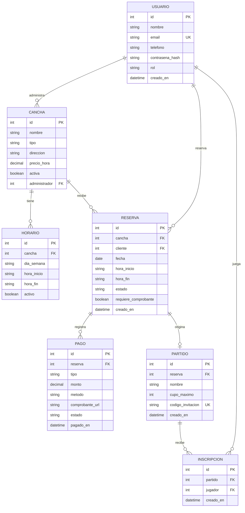
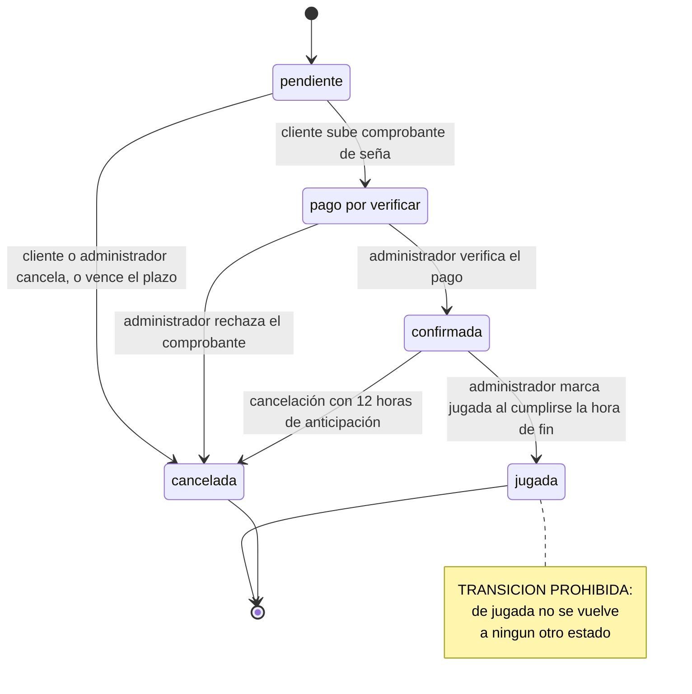

# Hito 1 · Ficha del negocio

**Pareja:** Nilo Aragundi · Jorge Castro

**Paralelo:** Aplicación para el Servidor Web A

**Negocio en una línea:** Sistema de reservas de canchas de fútbol sintéticas para dueños y administradores de complejos deportivos, centros de recreación, clubes de fútbol y ligas barriales que buscan digitalizar el alquiler de sus espacios.

## 1. Negocio de referencia

Nuestro caso de referencia es **Swift App**, fundada en Toronto (Canadá) en noviembre de 2021 por tres amigos, entre ellos Jeet Mehta. Vende un software para dueños de instalaciones deportivas —su nicho son los centros de béisbol bajo techo— que reemplaza las llamadas telefónicas y el registro manual: reservas en línea con un clic para el jugador, pagos en línea, horarios de instructores, personal y reportes del negocio. Quien paga es el dueño de la instalación, no el jugador. El fundador no publica la tarifa; la suscripción mensual la deducimos de su programa de referidos, que regala un mes gratis, y de que los pagos en línea pasan por Stripe. Declara que llegaron a 10.000 USD de ingresos al mes (unos 120.000 al año), que son rentables desde el primer día y que el valor de vida de cada cliente (LTV) ronda los 4.000 USD, cifra que él mismo llama aproximada. Son datos autodeclarados en 2022 y nadie los audita. Nuestro negocio comparte el problema (reservas de espacios deportivos), el cliente (el dueño del recinto) y la lógica de cobrarle a él; cambian el deporte y el país.

Caso: https://www.starterstory.com/stories/swift-app

## 2. Caso de contraste

El contraste es **Partidazo**, una app de reservas de canchas de fútbol 5 de La Plata (Argentina), iniciada en 2014. Su fundador, Juan Ignacio Arroyo, la documentó como fracaso en 2019 y cuenta que proyectos parecidos, como ClickyReserva, Matchear y Canchas.com.ar, se estancaron o desaparecieron en esos años.

**Hipótesis de fondo:** todos partían del problema del jugador y cobraban comisión por reserva, suponiendo que «más reservas» era una necesidad del dueño. Según el autor, el aumento posible era marginal, porque la mayor parte de los ingresos de un complejo viene de turnos fijos; su estimación más optimista era un 20 % más de facturación. Además, cuenta que algunos dueños no querían dejar registro de sus turnos e ingresos, así que el sistema les parecía una amenaza. Swift, en cambio, resuelve un problema del dueño (tiempo perdido en llamadas y cobros) y le cobra una suscripción. Por eso nuestro sistema parte del administrador: verificar pagos, exigir seña y ordenar sus turnos.

Caso: https://medium.com/@j.ignacioarroyo/aprendizajes-de-fundir-mi-primer-emprendimiento-7a77be35b70a

## 3. Adaptación al Ecuador

1. **Medios de pago.** La mayoría de los clientes en Ecuador paga por transferencia bancaria y envía la foto del comprobante, no con tarjeta. *Efecto:* la reserva no puede darse por confirmada apenas se crea, porque alguien tiene que revisar el comprobante. *Qué cambió:* la Reserva tiene un estado intermedio, `pago_por_verificar`, y el pago es una entidad propia (`Pago`) con su comprobante y su estado de verificación. **Esta es la restricción que cambió la máquina de estados.**

2. **Facturación electrónica del SRI y régimen RIMPE.** Muchos dueños de canchas sintéticas operan como emprendimientos pequeños inscritos en RIMPE (emprendedor o negocio popular), no como sociedades con facturación electrónica plena. *Efecto:* el sistema no puede asumir que cada reserva pagada genera una factura electrónica. *Qué cambió:* la Reserva lleva el atributo `requiere_comprobante` (sí/no), en lugar de forzar un flujo de facturación completo en este hito.

3. **Informalidad en las cancelaciones y poder adquisitivo.** Es común que un grupo reserve una cancha y no se presente sin avisar, y el dueño pierde ese horario. *Efecto:* hace falta un compromiso económico antes de bloquear el horario. *Qué cambió:* la reserva nace `pendiente` y solo se confirma cuando el administrador verifica una seña del 30 % del precio (un `Pago` de tipo `sena`); si el cliente no sube el comprobante en 24 horas, la reserva se cancela sola.

## 4. Modelo de datos

### Usuario

| Atributo | Tipo | Obligatorio | Ejemplo |
| --- | --- | --- | --- |
| id | número entero | sí | 1 |
| nombre | texto | sí | María Pérez |
| email | texto | sí | maria@gmail.com |
| telefono | texto | no | 0991234567 |
| contrasena_hash | texto | sí | $2a$10$… (contraseña cifrada, nunca en claro) |
| rol | uno de: cliente, administrador | sí | cliente |
| creado_en | fecha y hora | sí | 14-09-2026 10:32 |

*El email es único.*

### Cancha

| Atributo | Tipo | Obligatorio | Ejemplo |
| --- | --- | --- | --- |
| id | número entero | sí | 1 |
| nombre | texto | sí | Cancha El Golazo 1 |
| tipo | uno de: futbol_5, futbol_7, futbol_11 | sí | futbol_5 |
| direccion | texto | sí | Av. Los Shyris y Naciones Unidas |
| precio_hora | número decimal | sí | 25.00 |
| activa | sí/no | sí | sí |
| administrador | referencia a Usuario | sí | (id del administrador) |

### Horario

| Atributo | Tipo | Obligatorio | Ejemplo |
| --- | --- | --- | --- |
| id | número entero | sí | 1 |
| cancha | referencia a Cancha | sí | (id de la cancha) |
| dia_semana | uno de: lunes, martes, miercoles, jueves, viernes, sabado, domingo | sí | sabado |
| hora_inicio | texto (formato HH:MM) | sí | 18:00 |
| hora_fin | texto (formato HH:MM) | sí | 19:00 |
| activo | sí/no | sí | sí |

### Reserva

| Atributo | Tipo | Obligatorio | Ejemplo |
| --- | --- | --- | --- |
| id | número entero | sí | 1 |
| cancha | referencia a Cancha | sí | (id de la cancha) |
| cliente | referencia a Usuario | sí | (id del cliente) |
| fecha | fecha | sí | 21-10-2026 |
| hora_inicio | texto (formato HH:MM) | sí | 19:00 |
| hora_fin | texto (formato HH:MM) | sí | 20:00 |
| estado | uno de: pendiente, pago_por_verificar, confirmada, jugada, cancelada | sí | pendiente |
| requiere_comprobante | sí/no | sí | no |
| creado_en | fecha y hora | sí | 14-09-2026 10:32 |

### Pago

| Atributo | Tipo | Obligatorio | Ejemplo |
| --- | --- | --- | --- |
| id | número entero | sí | 1 |
| reserva | referencia a Reserva | sí | (id de la reserva) |
| tipo | uno de: sena, saldo | sí | sena |
| monto | número decimal | sí | 12.50 |
| metodo | uno de: transferencia, efectivo, tarjeta | sí | transferencia |
| comprobante_url | texto | no | https://.../comprobante123.jpg |
| estado | uno de: pendiente, verificado, rechazado | sí | pendiente |
| pagado_en | fecha y hora | no | 14-09-2026 10:40 |

### Partido *(valor agregado)*

| Atributo | Tipo | Obligatorio | Ejemplo |
| --- | --- | --- | --- |
| id | número entero | sí | 1 |
| reserva | referencia a Reserva | sí | (id de la reserva) |
| nombre | texto | sí | Picadito del sábado |
| cupo_maximo | número entero | sí | 10 |
| codigo_invitacion | texto | sí | K3F9QZ |
| creado_en | fecha y hora | sí | 14-09-2026 10:32 |

*La reserva es única (una reserva tiene, como mucho, un partido). El código de invitación tiene 6 caracteres y es único.*

### Inscripción *(valor agregado)*

| Atributo | Tipo | Obligatorio | Ejemplo |
| --- | --- | --- | --- |
| id | número entero | sí | 1 |
| partido | referencia a Partido | sí | (id del partido) |
| jugador | referencia a Usuario | sí | (id del usuario) |
| creado_en | fecha y hora | sí | 14-09-2026 10:32 |

*Un mismo jugador no puede inscribirse dos veces en el mismo partido.*

### Relaciones

| Entidades | Cardinalidad | Frase |
| --- | --- | --- |
| Usuario – Cancha | 1 a N | Un administrador administra muchas canchas; cada cancha pertenece a un solo administrador. |
| Usuario – Reserva | 1 a N | Un cliente hace muchas reservas; cada reserva pertenece a un solo cliente. |
| Cancha – Horario | 1 a N | Una cancha tiene muchos horarios recurrentes; cada horario pertenece a una sola cancha. |
| Cancha – Reserva | 1 a N | Una cancha recibe muchas reservas; cada reserva es de una sola cancha. |
| Reserva – Pago | 1 a N | Una reserva tiene uno o más pagos (seña y/o saldo); cada pago pertenece a una sola reserva. |
| Reserva – Partido | 1 a 1 | Una reserva confirmada tiene, como mucho, un partido; cada partido pertenece a una sola reserva. |
| Partido – Inscripción | 1 a N | Un partido tiene muchas inscripciones (hasta su cupo); cada inscripción pertenece a un solo partido. |
| Usuario – Inscripción | 1 a N | Un usuario puede inscribirse en muchos partidos; cada inscripción es de un solo usuario. |

**Decisión discutible:** Pago es una entidad y no un campo de la Reserva, porque una misma reserva puede tener más de un pago (la seña y luego el saldo) y cada uno necesita su propio método, comprobante, fecha y estado de verificación. Un solo campo «pagado: sí/no» en la Reserva no alcanza.

### Valor agregado: Partido e Inscripción

Una vez que una reserva está `confirmada`, su cliente puede convertirla en un partido: le pone nombre, define el cupo máximo, recibe un código de invitación único y lo comparte para que otros usuarios registrados se inscriban y se vea cuántos jugadores hay y cuántos cupos quedan. Solo se agregaron dos entidades (`Partido`, 1 a 1 con `Reserva`, e `Inscripcion`, 1 a N con `Partido` y con `Usuario`). Alcance controlado: `Partido` no tiene máquina de estados propia, porque depende del estado `confirmada` que ya existe; no se edita ni se elimina en este hito; cualquier usuario registrado puede unirse con el código (el control de acceso real queda para la semana de autenticación) y no hay notificaciones.

### Los structs en Go

```go
package models

import "time"

// --- Usuario ---

type Rol string

const (
	RolCliente       Rol = "cliente"
	RolAdministrador Rol = "administrador"
)

type Usuario struct {
	ID             uint      `gorm:"primaryKey" json:"id"`
	Nombre         string    `gorm:"size:120;not null" json:"nombre"`
	Email          string    `gorm:"size:160;uniqueIndex;not null" json:"email"`
	Telefono       string    `gorm:"size:20" json:"telefono,omitempty"`
	ContrasenaHash string    `gorm:"size:255;not null" json:"-"`
	Rol            Rol       `gorm:"type:varchar(20);not null" json:"rol"` // validado en el service: solo "cliente" o "administrador"
	CreadoEn       time.Time `gorm:"autoCreateTime" json:"creado_en"`
}

// --- Cancha ---

type TipoCancha string

const (
	TipoFutbol5  TipoCancha = "futbol_5"
	TipoFutbol7  TipoCancha = "futbol_7"
	TipoFutbol11 TipoCancha = "futbol_11"
)

type Cancha struct {
	ID              uint       `gorm:"primaryKey" json:"id"`
	Nombre          string     `gorm:"size:120;not null" json:"nombre"`
	Tipo            TipoCancha `gorm:"type:varchar(20);not null" json:"tipo"` // validado en el service: los tres valores de TipoCancha
	Direccion       string     `gorm:"size:200;not null" json:"direccion"`
	PrecioHora      float64    `gorm:"not null" json:"precio_hora"`
	Activa          bool       `gorm:"default:true" json:"activa"`
	AdministradorID uint       `gorm:"not null;index" json:"administrador_id"`
	Administrador   *Usuario   `gorm:"foreignKey:AdministradorID" json:"administrador,omitempty"`
}

// --- Horario (plantilla semanal de disponibilidad) ---

type DiaSemana string

const (
	Lunes     DiaSemana = "lunes"
	Martes    DiaSemana = "martes"
	Miercoles DiaSemana = "miercoles"
	Jueves    DiaSemana = "jueves"
	Viernes   DiaSemana = "viernes"
	Sabado    DiaSemana = "sabado"
	Domingo   DiaSemana = "domingo"
)

type Horario struct {
	ID         uint      `gorm:"primaryKey" json:"id"`
	CanchaID   uint      `gorm:"not null;index" json:"cancha_id"`
	Cancha     *Cancha   `gorm:"foreignKey:CanchaID" json:"-"`
	DiaSemana  DiaSemana `gorm:"type:varchar(15);not null" json:"dia_semana"` // validado en el service: los siete valores de DiaSemana
	HoraInicio string    `gorm:"size:5;not null" json:"hora_inicio"`          // formato "HH:MM"
	HoraFin    string    `gorm:"size:5;not null" json:"hora_fin"`
	Activo     bool      `gorm:"default:true" json:"activo"`
}

// --- Reserva (entidad con máquina de estados) ---

type EstadoReserva string

const (
	EstadoPendiente        EstadoReserva = "pendiente"
	EstadoPagoPorVerificar EstadoReserva = "pago_por_verificar"
	EstadoConfirmada       EstadoReserva = "confirmada"
	EstadoJugada           EstadoReserva = "jugada"
	EstadoCancelada        EstadoReserva = "cancelada"
)

type Reserva struct {
	ID                  uint          `gorm:"primaryKey" json:"id"`
	CanchaID            uint          `gorm:"not null;index" json:"cancha_id"`
	Cancha              *Cancha       `gorm:"foreignKey:CanchaID" json:"cancha,omitempty"`
	ClienteID           uint          `gorm:"not null;index" json:"cliente_id"`
	Cliente             *Usuario      `gorm:"foreignKey:ClienteID" json:"cliente,omitempty"`
	Fecha               time.Time     `gorm:"type:date;not null" json:"fecha"`
	HoraInicio          string        `gorm:"size:5;not null" json:"hora_inicio"`
	HoraFin             string        `gorm:"size:5;not null" json:"hora_fin"`
	Estado              EstadoReserva `gorm:"type:varchar(25);not null;default:pendiente" json:"estado"` // validado en el service: los cinco valores y solo las transiciones de la sección 5
	RequiereComprobante bool          `gorm:"not null;default:false" json:"requiere_comprobante"`
	Pagos               []Pago        `gorm:"foreignKey:ReservaID" json:"pagos,omitempty"`
	CreadoEn            time.Time     `gorm:"autoCreateTime" json:"creado_en"`
}

// --- Pago ---

type TipoPago string

const (
	TipoSena  TipoPago = "sena"
	TipoSaldo TipoPago = "saldo"
)

type MetodoPago string

const (
	MetodoTransferencia MetodoPago = "transferencia"
	MetodoEfectivo      MetodoPago = "efectivo"
	MetodoTarjeta       MetodoPago = "tarjeta"
)

type EstadoPago string

const (
	PagoPendiente  EstadoPago = "pendiente"
	PagoVerificado EstadoPago = "verificado"
	PagoRechazado  EstadoPago = "rechazado"
)

type Pago struct {
	ID             uint       `gorm:"primaryKey" json:"id"`
	ReservaID      uint       `gorm:"not null;index" json:"reserva_id"`
	Tipo           TipoPago   `gorm:"type:varchar(10);not null" json:"tipo"`      // validado en el service: "sena" o "saldo"
	Monto          float64    `gorm:"not null" json:"monto"`
	Metodo         MetodoPago `gorm:"type:varchar(20);not null" json:"metodo"`    // validado en el service: los tres valores de MetodoPago
	ComprobanteURL *string    `gorm:"size:255" json:"comprobante_url,omitempty"`
	Estado         EstadoPago `gorm:"type:varchar(15);not null;default:pendiente" json:"estado"` // validado en el service: los tres valores de EstadoPago
	PagadoEn       *time.Time `json:"pagado_en,omitempty"`
}

// --- Partido (valor agregado) ---

type Partido struct {
	ID               uint          `gorm:"primaryKey" json:"id"`
	ReservaID        uint          `gorm:"uniqueIndex;not null" json:"reserva_id"` // única: 1 a 1 con Reserva
	Nombre           string        `gorm:"size:120;not null" json:"nombre"`
	CupoMaximo       int           `gorm:"not null" json:"cupo_maximo"`
	CodigoInvitacion string        `gorm:"size:6;uniqueIndex;not null" json:"codigo_invitacion"`
	Inscripciones    []Inscripcion `gorm:"foreignKey:PartidoID" json:"inscripciones,omitempty"`
	CreadoEn         time.Time     `gorm:"autoCreateTime" json:"creado_en"`
}

// --- Inscripción (valor agregado) ---

type Inscripcion struct {
	ID        uint      `gorm:"primaryKey" json:"id"`
	PartidoID uint      `gorm:"not null;uniqueIndex:idx_partido_jugador" json:"partido_id"`
	JugadorID uint      `gorm:"not null;uniqueIndex:idx_partido_jugador" json:"jugador_id"` // ID de un Usuario; cualquier rol puede jugar
	CreadoEn  time.Time `gorm:"autoCreateTime" json:"creado_en"`
}
```

**Decisión de tipos:** `HoraInicio` y `HoraFin` (en `Horario` y en `Reserva`) son `string` en formato `"HH:MM"` y no `time.Time`, porque representan solo una hora del día dentro de una plantilla semanal o de una reserva puntual; usar `time.Time` obligaría a inventar una fecha arbitraria para cada hora y complicaría las comparaciones sin aportar nada. En cambio, `ComprobanteURL` y `PagadoEn` en `Pago` son punteros (`*string`, `*time.Time`), porque mientras el pago está `pendiente` esos datos legítimamente no existen todavía: un puntero nulo distingue «no llegó comprobante» de «comprobante vacío», cosa que un `string` normal no puede hacer.

### Diagrama del modelo



## 5. Máquina de estados

La entidad con estados es la **Reserva**.

### Tabla de estados

| Estado | Qué significa en el negocio |
| --- | --- |
| **pendiente** (inicial) | El cliente creó la reserva pero todavía no subió el comprobante de la seña (30 % del precio). |
| pago_por_verificar | El cliente subió el comprobante de la seña y espera que el administrador lo revise. |
| confirmada | El administrador verificó la seña; el horario queda bloqueado para cualquier otro cliente. |
| jugada | Se cumplió la fecha y hora de la reserva sin que se cancelara antes. |
| cancelada | La reserva se anuló, por el cliente o por el administrador, antes de jugarse. |

### Tabla de transiciones

| De | A | Quién la hace | Condición |
| --- | --- | --- | --- |
| pendiente | pago_por_verificar | cliente | Sube el comprobante de transferencia de la seña (30 % del precio de la cancha). |
| pendiente | cancelada | cliente, administrador o el sistema | El cliente o el administrador la cancelan antes de que haya comprobante, o el sistema la cancela solo si pasan 24 horas sin comprobante. |
| pago_por_verificar | confirmada | administrador | Verifica que el monto y los datos del comprobante correspondan a la seña esperada. |
| pago_por_verificar | cancelada | administrador | Rechaza el comprobante (monto insuficiente, dato ilegible, no corresponde a esa cuenta). |
| confirmada | cancelada | cliente o administrador | Se solicita con al menos 12 horas de anticipación a la hora de inicio. |
| confirmada | jugada | administrador | Se cumplió la hora de fin de la reserva sin que se haya cancelado antes. |

### Diagrama de estados



**Transición prohibida:** de **jugada** no se vuelve a **cancelada** ni a ningún otro estado. Si hubiera un reclamo después de jugado el partido (por ejemplo, la cancha estaba en mal estado), se maneja como un reembolso o una nota aparte, pero la reserva original queda como jugada. De lo contrario, las estadísticas de ocupación de la cancha y el historial de pagos quedarían falseados, y un administrador podría «deshacer» una reserva ya disfrutada para devolver dinero indebidamente.

## 6. Roles y permisos

| Acción | Cliente | Administrador |
| --- | --- | --- |
| Crear reserva | solo las suyas | no |
| Ver reservas | solo las suyas | todas las de sus canchas |
| Subir comprobante de pago (seña o saldo) | solo las suyas | no |
| Verificar o rechazar un comprobante de pago | no | solo las suyas |
| Cancelar una reserva | solo las suyas (pendiente o confirmada) | solo las suyas (pendiente o confirmada) |
| Marcar una reserva como jugada | no | solo las suyas |
| Crear o editar una cancha | no | solo las suyas |
| Definir o editar los horarios de una cancha | no | solo las suyas |
| Ver reportes de ingresos | no | solo las suyas |
| Crear un partido para una reserva confirmada *(valor agregado)* | solo las suyas | no |
| Unirse a un partido con un código *(valor agregado)* | sí | no |
| Ver el detalle de un partido *(valor agregado)* | sí | sí |

Para el administrador, «las suyas» significa las de sus propias canchas. La cancelación automática de una reserva `pendiente` a las 24 horas la ejecuta el sistema, no un rol.

## 7. Mapa de endpoints por rol

| Endpoint | Rol que lo llama | Pantalla que lo consume | Qué devuelve | Qué valida | Código si falla |
| --- | --- | --- | --- | --- | --- |
| GET /canchas | cliente, administrador | Catálogo de canchas · Nueva reserva · Mis canchas | 200 OK · lista de canchas: nombre, tipo, precio por hora, dirección, activa | El cliente solo recibe canchas con `activa = true`; el administrador solo recibe las suyas (activas e inactivas) | 401 si no está autenticado · 500 si hay error del servidor |
| POST /canchas | administrador | Mis canchas | 201 Created · la cancha creada, con su id | Nombre y dirección no vacíos; `precio_hora > 0`; `tipo` es uno de los valores permitidos; la cancha queda a nombre del administrador autenticado | 422 si los datos no son válidos · 401 si no está autenticado · 403 si su rol no es administrador |
| POST /reservas | cliente | Nueva reserva | 201 Created · la reserva creada, en estado `pendiente` | Que la cancha exista y esté activa; que el horario pedido no se cruce con otra reserva confirmada; `requiere_comprobante` es opcional (por defecto no) | 409 si el horario ya está ocupado · 422 si faltan datos o la cancha no está activa |
| GET /reservas | cliente, administrador | Mis reservas (cliente) · Bandeja de reservas (administrador) | 200 OK · lista de reservas con cancha, fecha, hora y estado | El cliente solo ve las suyas; el administrador solo ve las de sus canchas | 401 si no está autenticado |
| GET /reservas/{id} | cliente, administrador | Detalle de la reserva | 200 OK · la reserva con su cancha, cliente, pagos y estado | Que la reserva sea del cliente que la pide o de una cancha del administrador que la pide | 404 si el id no existe · 403 si la reserva no es suya ni de sus canchas |
| PATCH /reservas/{id}/estado | cliente, administrador | Detalle de la reserva | 200 OK · la reserva con su nuevo estado | Que la transición pedida esté permitida según la tabla de la sección 5 (por ejemplo, no se puede pasar de jugada a cancelada) y que el rol tenga permiso. En `pendiente → pago_por_verificar` el cuerpo trae `comprobante_url` y se crea el `Pago` de tipo `sena`; en `pago_por_verificar → confirmada` o `cancelada` ese pago pasa a `verificado` o `rechazado` | 400 si la transición no es válida · 403 si el rol no tiene permiso para esa transición · 404 si el id no existe |

### Matriz pantalla × endpoint

| Pantalla | GET /canchas | POST /canchas | POST /reservas | GET /reservas | GET /reservas/{id} | PATCH /reservas/{id}/estado |
| --- | --- | --- | --- | --- | --- | --- |
| Catálogo de canchas (cliente) | ✔ | | | | | |
| Nueva reserva (cliente) | ✔ | | ✔ | | | |
| Mis reservas (cliente) | | | | ✔ | | |
| Mis canchas (administrador) | ✔ | ✔ | | | | |
| Bandeja de reservas (administrador) | | | | ✔ | | |
| Detalle de la reserva (ambos) | | | | | ✔ | ✔ |

Las acciones de la sección 6 que no aparecen en este mapa de seis endpoints (editar una cancha, definir horarios, reportes y el módulo Partido) quedan fuera de él.

Endpoints que ya funcionan: `POST /login`, `GET /canchas`, `POST /canchas`, `PATCH /canchas/{id}`, `POST /reservas`, `GET /reservas`, `GET /reservas/{id}`, `PATCH /reservas/{id}/estado`, `POST /partidos`, `GET /partidos/{id}` y `POST /partidos/{id}/inscripciones`, registrados en `main.go` (`nuevoEnrutador`) y en los métodos `Rutas` de cada paquete de `internal/`.

## 8. Declaración de IA

Usamos Claude (Anthropic) de apoyo para redactar y estructurar las secciones 3 a 7 (restricciones locales, modelo con structs y diagramas, máquina de estados, roles y mapa de endpoints), y para verificar las fuentes de las secciones 1 y 2. Las decisiones de negocio (nombre del proyecto, entidades finales, monto de la seña, valor agregado y su alcance) y la elección de los dos casos fueron nuestras. Para la revisión final del Hito 2 se usó DeepSeek V4.1 Flash como apoyo para contrastar la lista de comprobación y revisar la documentación; cada cambio se validó con las pruebas del repositorio.
